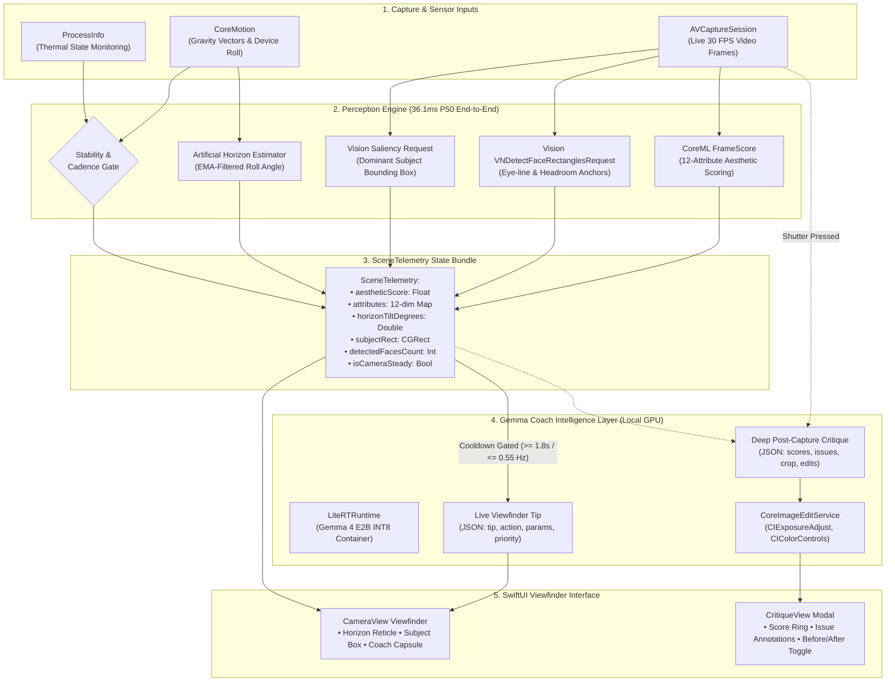

# LensCoach: On-Device Multimodal Photography Guidance Engine
**Real-Time On-Device Perception (36.1 ms P50) and Composition Guidance on Apple Silicon & iOS**  
*Apple Neural Engine CoreML FrameScore • Google Gemma 4 E2B LiteRT INT8 • Native SwiftUI Viewfinder*

[](https://developer.apple.com/ios/)
[](https://huggingface.co/VenuArvind/lenscoach-gemma4-e2b)
[](https://developer.apple.com/machine-learning/core-ml/)
[](https://ai.google.dev/edge/litert)
[](https://opensource.org/licenses/MIT)

> **Key Result:** On a physical **iPhone 15 (`iPhone15,4`, A16 Bionic, 6 GB RAM)**, **CoreML `FrameScore` (ANE) + Apple Vision + CoreMotion** perception runs at **36.10 ms P50** (`30.00 FPS` P50/P95, `75.20 MB` P50 RSS without VLM load), while bundled multimodal **Gemma 4 E2B (`gemma-4-E2B-it.litertlm`, `2.47 GB`)** runs natively on the iPhone’s Metal GPU via `LiteRTLM` (`0.19.1`) at **55.4–57.0 tok/s** (**613.5–631.7 ms** total, **1,060–1,237.9 MB** `phys_footprint`). Off-device Mac M5 (`bfloat16`) eval of the QLoRA fine-tune (`VenuArvind/lenscoach-gemma4-e2b`) is also included below.

---

## 📱 Viewfinder Demo

```
+-----------------------------------------------------------+
|  [ 30 FPS ]  [ Latency: 36ms ]  [ LiteRT: INT8 ]  [ Level ]  |
|                                                           |
|                       [ Face Box ]                        |
|                     +--------------+                      |
|                     |   Eye Line   |                      |
|                     +--------------+                      |
|          -------------------+-------------------          |
|                             |                             |
|       [ "Tilt ~2° clockwise to level horizon" ]           |
|                                                           |
+-----------------------------------------------------------+
```

---

## Quickstart (3 Commands)

```bash
# 1. Download packaged Gemma 4 LiteRT model bundle
./scripts/setup_models.sh

# 2. Open project in Xcode 15+
open LensCoachNative/LensCoachNative.xcodeproj

# 3. Select physical iPhone target and press Cmd + R to build and deploy
```

---

## Empirical Benchmarks & Hardware Profiling

### 1. Physical iPhone 15 Profiling (Multimodal Metal GPU + 10-Min Perception Baseline)

Profiled on a physical **iPhone 15 (`iPhone15,4`, A16 Bionic, 6 GB RAM)** via `DiagnosticsManager`:

1. **Live Multimodal Metal GPU Capture (`diagnostics_iphone_multimodal.csv`, ~55s):** Running `gemma-4-E2B-it.litertlm` (`2.47 GB`, `visionBackend: .gpu`, `1152×864 → 912×672` / `2,394` patches):
   * **Multimodal VLM Inference:** `613.5 ms` (`57.0 tok/s`) and `631.7 ms` (`55.4 tok/s`), `29–30 FPS` viewfinder during active inference, `ThermalState = 0` (Nominal).
   * **RSS vs. Jetsam `phys_footprint`:** `resident_size` RSS `111.6–218.1 MB`; `task_vm_info.phys_footprint` **`1,060–1,237.9 MB`** (`~1.21 GB` peak).
2. **10-Minute Sustained Perception Baseline (`diagnostics_session_10min.csv`, no VLM load):** `606` 1 Hz snapshots while connected to power:

| Metric | P50 (Median) | P95 Latency | Mean / Bounds | Notes |
| :--- | :---: | :---: | :---: | :--- |
| **Viewfinder Cadence** | **30.00 FPS** | **30.00 FPS** | **27.20 FPS** | `p5 = 23.0 FPS` (startup & occasional stalls) |
| **Perception Latency** | **36.10 ms** | **40.72 ms** | **34.72 ms** | CoreML `FrameScore` (ANE) + Vision + CoreMotion |
| **Perception RSS (no VLM)** | **75.20 MB** | **99.60 MB** | **118.30 MB peak** | SwiftUI + CoreML (without `2.47 GB` VLM loaded) |
| **Thermal State (no VLM)** | **Nominal (State 0)** | **Nominal (State 0)** | **100.0% Nominal** | Connected to power during 10-min capture |

*Raw telemetry committed in [`diagnostics_iphone_multimodal.csv`](diagnostics_iphone_multimodal.csv) and [`diagnostics_session_10min.csv`](diagnostics_session_10min.csv).*

---

### 2. Real Multimodal Evaluation: Base Gemma 4 E2B vs. QLoRA Adapter (`Apple M5 MPS`)

Evaluated real `bfloat16` multimodal inference on Apple M5 MPS (`Training/run_real_gemma4_eval.py`) across **20 held-out synthetic flaws** (`tilt`, `underexposed`, `overexposed`, `framing`) + **10 real unperturbed AADB test photos**, passing both the image frame and `Aesthetic score` + schema prompt:

| Model Architecture | Synth Strict JSON | Real AADB Strict JSON | Flaw Action Accuracy | MPS Latency (P50 / P95) |
| :--- | :---: | :---: | :---: | :---: |
| **Base `google/gemma-4-E2B-it` (Zero-Shot)** | **100.0%** (20/20) | 80.0% (8/10) | 25.0% (5/20) | 2,786.9 / 4,406.4 ms |
| **`VenuArvind/lenscoach-gemma4-e2b` (QLoRA)** | 95.0% (19/20) | **100.0%** (10/10) | **35.0%** (7/20) | **2,221.3 / 3,021.8 ms** |

*Findings:* Even when text telemetry omitted exposure/tilt hints (`Aesthetic score: 5.8/10`), QLoRA-tuned Gemma 4 identified underexposure directly from pixels (`"Increase exposure (+1.0 EV)..."`), whereas zero-shot Gemma 4 gave generic posing advice. However, purely visual action classification without `CoreMotion` tilt / `FrameScore` weakest-attribute hints in the prompt remains noisy (`35.0%` action accuracy; `1/5` tilt cases parsed with `7.0°` error), confirming why V2 pairs sensor telemetry with visual frames. Raw results saved to [`Training/real_gemma4_evaluation_results.json`](Training/real_gemma4_evaluation_results.json). *(Note: `Training/evaluate_gemma4_flaws.py` is an earlier simulated scaffold superseded by `run_real_gemma4_eval.py`.)*

---

## Quantization & Edge Deployment Architecture

| Pipeline Stage | Model Identifier | Precision & Quantization Recipe | Target Hardware Engine | Memory Footprint | Validation Metric |
| :--- | :--- | :--- | :--- | :--- | :--- |
| **Aesthetic Scoring** | `FrameScore.mlmodelc` | Float16 CoreML MLProgram | Apple Neural Engine (ANE) | 18 MB | **SRCC = 0.682** (AADB test split) |
| **Face & Saliency** | Apple Vision Framework | Native OS Hardware Pipeline | CPU / ANE | Shared OS memory | Sub-pixel eye & headroom anchors |
| **Coaching Engine** | `gemma-4-E2B-it.litertlm` | **Mixed 2/4/8-bit LiteRT** | iOS Metal GPU (LiteRT-LM `0.19.1`) | `2.47 GB` bundle (`1.21 GB` peak `phys_footprint`) | **55.4–57.0 tok/s** (`613.5–631.7 ms`, iPhone 15) |
| **Post-Shot Edits** | `CoreImageEditService` | Float32 GPU Shader Pipeline | Apple Metal GPU | In-place texture buffers | Parametric Metal shader dispatch |

> **Architecture Clarification:** V1 of LensCoach previously experimented with 4-bit GGUF via llama.cpp (`Phi-3-mini-4k-instruct-q4.gguf`). V2 completely replaces this with a native Google AI Edge LiteRT container running **Dynamic INT8** on Metal GPU, enabling direct multimodal frame grounding and stable thermal budgeting.

---

## System Architecture



---

## Limitations & What's Next

1. **Exporting the QLoRA Fine-Tune to `.litertlm` & On-Device Parse Rate:** The iPhone build currently runs Google’s base multimodal `gemma-4-E2B-it.litertlm` (`2.47 GB`) with `ruleFallbackViewfinder` as a silent fallback if JSON parsing fails. Exporting `VenuArvind/lenscoach-gemma4-e2b` via `litert-torch` (`--export_vision_encoder=True`) and logging on-device JSON parse rate is next.
2. **Unplugged 10-Minute Multimodal Stress Test:** The 10-minute session (`diagnostics_session_10min.csv`) ran on USB-C power without active Metal GPU VLM inference, while `diagnostics_iphone_multimodal.csv` was a ~55-second run. Measuring unplugged battery drain and thermal throttling over 10 minutes with active Metal GPU VLM calls is next.
3. **Sensor-Fused Fine-Tuning:** Preliminary Mac `mps` evaluation (`n=20/10`) showed that passing only `Aesthetic score` + image yields `35.0%` flaw-action accuracy (`143.5` vs `228.5` median output chars explaining the latency gap); training and testing a larger paired `(image + CoreMotion + FrameScore)` dataset is next.

---

## License

Licensed under the [MIT License](LICENSE).
