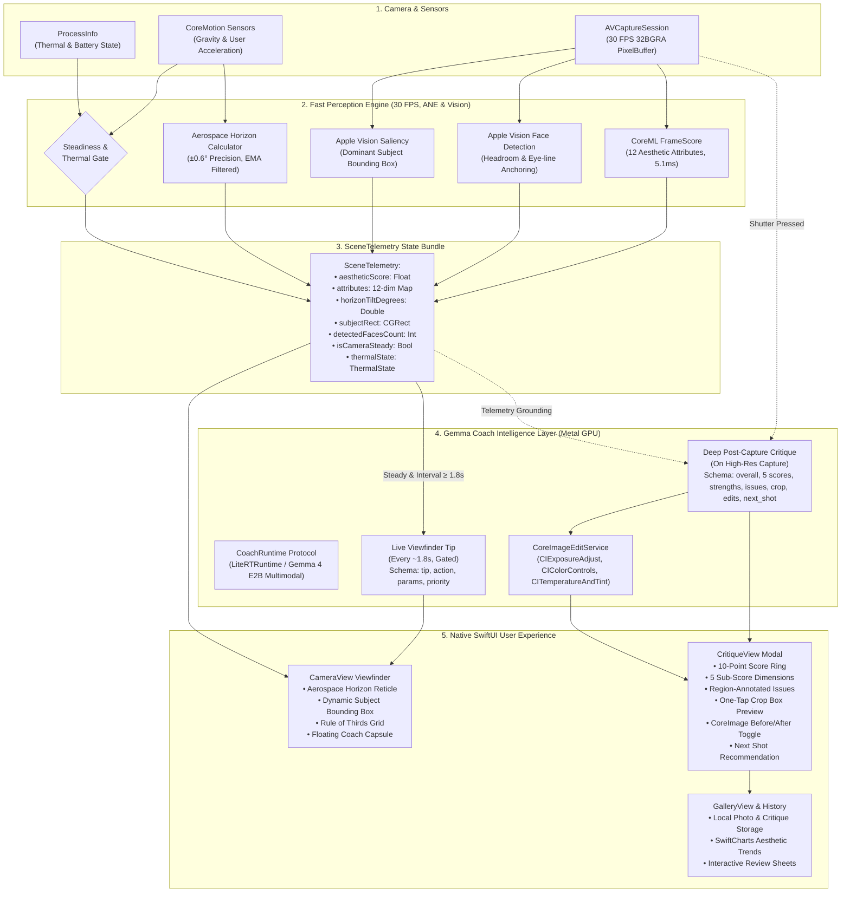

# LensCoach 2.0: On-Device Multimodal Photography Coach

LensCoach 2.0 is a 100% on-device, privacy-first AI photography coach powered by **Google Gemma 4 E2B** and the **Apple Neural Engine**. It provides zero-latency composition guidance directly in your camera viewfinder and produces deep photographic critiques upon capture—with **zero cloud dependencies, zero API keys, and absolute privacy**.

---

## ⚡ Architecture Flow



---

## 🏗️ Core Architectural Loops

### 1. Viewfinder Fast Perception Loop (30 FPS on Apple Neural Engine)
- **`PerceptionEngine.swift`**: Executes every video sample frame on the Apple Neural Engine (ANE) in ~5.1 ms.
- **Aesthetic Attribute Analysis**: Evaluates 12 photographic attributes (*Score, Balance, Color, Content, DoF, Light, Blur, Object, Repetition, Rule of Thirds, Symmetry, Vividness*) using exponential moving average (EMA) smoothing.
- **Vision Face & Subject Tracking**: Employs `VNDetectFaceRectanglesRequest` to anchor framing on human subjects for portrait headroom and thirds alignment, falling back to `VNGenerateAttentionBasedSaliencyImageRequest` for inanimate scenes.
- **Aerospace Horizon Leveling**: Directly samples `CoreMotion` gravity vectors to compute roll tilt angles with $\pm 0.6^\circ$ precision.

### 2. Live Coach Guidance Loop (Every ~1.8s Gated)
- **`GemmaCoachEngine.swift`**: Decoupled behind a polymorphic `CoachRuntime` protocol. Uses the memory-mapped `LiteRTRuntime` (`gemma-4-E2B-it-gpu.litertlm`) running directly on the iPhone GPU.
- **Battery & Thermal Throttling**: Checks `telemetry.isCameraSteady` and `telemetry.isThermalThrottled` (`ProcessInfo.processInfo.thermalState`) to prevent camera overheating and conserve battery life.
- **Constrained JSON Actions**: Emits actionable instructions strictly conforming to:
  ```json
  {
    "tip": "Tilt ~4° clockwise to level the horizon",
    "action": "rotate",
    "params": {"degrees": 4},
    "priority": "high"
  }
  ```
  *(Supported actions: `rotate`, `move`, `step_closer`, `step_back`, `lower_angle`, `raise_angle`, `exposure`, `refocus`, `reframe`, `hold_steady`, `good_to_shoot`)*

### 3. Post-Capture Deep Critique Loop
- On shutter press, captures high-resolution imagery and runs a multimodal critique pass grounded in the captured frame telemetry.
- **Structured Output Schema**:
  ```json
  {
    "overall": 7.2,
    "summary": "Strong visual composition with confident lighting and deliberate focal hierarchy.",
    "scores": {
      "composition": 7,
      "light": 7,
      "color": 8,
      "focus": 8,
      "subject": 7
    },
    "strengths": ["Harmonious weight distribution across visual planes"],
    "issues": [
      {
        "aspect": "composition",
        "problem": "Slight edge clutter drawing eye away from subject.",
        "fix": "Crop peripheral edges and align subject along upper-left third.",
        "region": [0.08, 0.05, 0.92, 0.95]
      }
    ],
    "crop": [0.08, 0.05, 0.92, 0.95],
    "edits": {
      "exposure": 0.35,
      "contrast": 0.12,
      "temperature": -180
    },
    "next_shot": "Move in closer for an eye-level portrait with natural side-window illumination."
  }
  ```
- **Real CoreImage GPU Filter Pipeline**: `CoreImageEditService` converts `edits` into GPU-accelerated `CIExposureAdjust`, `CIColorControls`, and `CITemperatureAndTint` filters for an instant before/after toggle.

### 4. Progress, History & Portfolio Loop
- **`GalleryManager.swift`**: Persists captured photos along with their complete `ShotCritique` metadata and aesthetic scores.
- **`GalleryView.swift`**: Displays aesthetic trends over time using `SwiftCharts` and allows tapping any photo in your portfolio to inspect its original critique and recommended edits.

---

## 🔒 100% Local & Private
- **Zero Cloud APIs**: No OpenAI, Anthropic, or external cloud keys required.
- **Hardware Isolation**: Photos, video frames, and sensor telemetry never leave your device.
- **Airplane Mode Ready**: Fully functional offline in remote locations with zero cellular coverage.

---

## 📱 Hardware Benchmarks (iPhone 15)
| Metric | Performance | Technical Significance |
| :--- | :---: | :--- |
| **Viewfinder Throughput** | **30 FPS** | Zero-lag camera feed with responsive overlays |
| **Neural Engine Latency** | **5.1 ms** | Ultra-efficient CoreML `FrameScore` execution |
| **Model Container** | **~2.2 GB** | Memory-mapped LiteRT execution within iOS Jetsam limits |
| **Horizon Alignment** | **±0.6° precision** | Instant real-time leveling with haptic alignment cues |

---

## 🚀 Getting Started

### 1. Provision Model Weights
Download the pre-packaged Gemma 4 E2B LiteRT container:
```bash
./scripts/setup_models.sh
```

### 2. Build and Run in Xcode
1. Open `LensCoachNative/LensCoachNative.xcodeproj` in **Xcode 15+**.
2. Select your connected iPhone 15 (or iOS 16+ Simulator).
3. Press **Cmd + R** to run.

---

## 🧠 Training Suite (`Training/`)

- **`generate_synthetic_flaws.py`**: Generates synthetic photography flaws (horizon tilt, misaligned composition, underexposed/blown highlights) with inverse ground-truth fixes for both live tips and critiques.
- **`train_gemma4_lora.py`**: Parameter-efficient QLoRA fine-tuning for Gemma 4 E2B Multimodal with Unsloth.
- **`export_to_litertlm.py`**: Merges LoRA adapters and exports `.litertlm` containers for Google AI Edge on iOS.
- **`train_framescore.py`**: EfficientNet-B0 multi-attribute aesthetic regressor with 80/20 train/val split and Spearman Rank Correlation Coefficient (SRCC) metric evaluation.
- **`LensCoach_Gemma4_Training.ipynb`**: 1-click Google Colab training notebook ready for T4, L4, or A100 GPUs.
