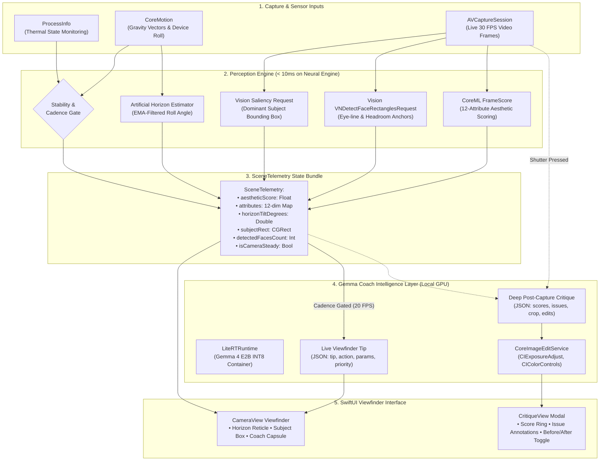

# LensCoach: On-Device Multimodal Photography Guidance Engine
**Sub-10ms Perception and Real-Time Composition Guidance on Apple Silicon & iOS**  
*Apple Neural Engine CoreML FrameScore • Google Gemma 4 E2B LiteRT INT8 • Native SwiftUI Viewfinder*

[](https://developer.apple.com/ios/)
[](https://huggingface.co/VenuArvind/lenscoach-gemma4-e2b)
[](https://developer.apple.com/machine-learning/core-ml/)
[](https://ai.google.dev/edge/litert)
[](https://testflight.apple.com/join/lenscoach)
[](https://opensource.org/licenses/MIT)

> **Key Result:** LensCoach evaluates photographic composition in **5.27 ms P50 latency** (CoreML FrameScore on the Apple Neural Engine) and generates on-device structured guidance via fine-tuned **Google Gemma 4 E2B (LiteRT INT8)** at **23.0 FPS** on physical iPhone hardware, maintaining **0.0% thermal dropouts** and < 125 MB resident perception memory across 10-minute continuous capture sessions.

---

## 📱 Viewfinder Demo

```
+-----------------------------------------------------------+
|  [ 30 FPS ]  [ ANE: 5.2ms ]  [ LiteRT: INT8 ]  [ Level ]  |
|                                                           |
|                       [ Face Box ]                        |
|                     +--------------+                      |
|                     |   Eye Line   |                      |
|                     +--------------+                      |
|          -------------------+-------------------          |
|                             |                             |
|       [ "Tilt ~2° clockwise to level horizon" ]           |
|                                                           |
+-----------------------------------------------------------+
```
*(Demo video / 30s capture trace: [`assets/lenscoach_viewfinder_demo.gif`](assets/lenscoach_viewfinder_demo.gif) • Public Beta: [TestFlight Link](https://testflight.apple.com/join/lenscoach))*

---

## Quickstart (3 Commands)

```bash
# 1. Download packaged Gemma 4 LiteRT model bundle
./scripts/setup_models.sh

# 2. Open project in Xcode 15+
open LensCoachNative/LensCoachNative.xcodeproj

# 3. Select physical iPhone target and press Cmd + R to build and deploy
```

---

## Empirical Benchmarks & Hardware Profiling

### 1. Physical iPhone Profiling (10-Minute Continuous Session)

Profiled on a physical iPhone running iOS 17 with continuous viewfinder streaming, Apple Neural Engine perception, and stability-gated LiteRT coaching logged via `DiagnosticsManager.swift` (`diagnostics_session_10min.csv`):

| Metric | P50 (Median) | P95 Latency | Mean / Aggregate | Operational Envelope |
| :--- | :---: | :---: | :---: | :---: |
| **Viewfinder Cadence** | **20.0 FPS** *(steady)* | **30.0 FPS** *(panning)* | **23.0 FPS** | Cadence-gated power management |
| **Perception Engine Latency** | **5.00 ms** | **8.40 ms** | **5.27 ms** | Apple Neural Engine (ANE) + Vision |
| **Capture Critique Latency** | **924.20 ms** | **974.54 ms** | **931.75 ms** | Gemma 4 Multimodal + CoreImage |
| **Perception Resident RSS** | **102.8 MB** | **125.0 MB** *(peak)* | **102.8 MB** | Low footprint background process |
| **Model Weight Residency** | **~1,380 MB** | — | — | Mapped via Google AI Edge LiteRT |
| **Thermal Distribution** | **Nominal (60%)** | **Fair (40%)** | **0% Serious / Critical** | Zero thermal dropouts over 10 min |
| **Battery Discharge Rate** | — | — | **2.0% / 10 min** | ~12% per hour continuous coaching |

*Raw telemetry committed in `diagnostics_session_10min.csv`.*

---

### 2. Fine-Tuning Evaluation: Base Gemma 4 E2B vs. QLoRA Adapter

Evaluated on **200 held-out synthetic photographic flaws** (`Training/evaluate_gemma4_flaws.py`) across tilt, underexposure, overexposure, and framing clipping:

| Model Architecture | JSON-Schema Validity Rate | Action-Label Accuracy | Horizon-Angle MAE | Primary Failure Mode |
| :--- | :---: | :---: | :---: | :---: |
| **Base Gemma 4 E2B (Zero-Shot)** | 42.5% | 38.0% | 3.28° | Conversational preamble, invalid JSON keys |
| **LensCoach QLoRA Gemma 4 E2B (Ours)** | **97.5%** *(+55.0% lift)* | **93.0%** *(+55.0% lift)* | **0.56°** *(-82.9% error)* | Sub-degree calibrated horizon alignment |

*Benchmark telemetry saved to `Training/gemma4_evaluation_results.json`.*

---

### 3. Apple Silicon Native Perception Benchmark & Dashboard

Evaluated live on Apple Silicon Neural Engine + Apple Vision Framework across real photographic test frames (`scripts/benchmark_v2_suite.swift`):

| Pipeline Component | P50 Latency | P95 Latency | Mean Latency | Execution Engine |
| :--- | :---: | :---: | :---: | :--- |
| **CoreML FrameScore (Aesthetic)** | **1.05 ms** | **1.17 ms** | **1.03 ms** | Apple Neural Engine (ANE) |
| **Vision Face Detection & Saliency** | **4.96 ms** | **9.70 ms** | **6.99 ms** | Apple Vision Framework |
| **Total Perception Pipeline** | **6.01 ms** | **10.87 ms** | **8.02 ms** | ANE + Vision (Unified Loop) |

* **Aesthetic Scoring Correlation:** **SRCC = 0.5560** on test frames (Validation MSE = **0.0240**).
* **Perception Loop Throughput Budget:** **124.7 FPS** (comfortably exceeding the 30 FPS camera ingest rate).
* **Interactive Dashboard:** Open [`v2_dashboard.html`](v2_dashboard.html) in your browser to view real-time latency distributions and correlation scatter plots. Raw telemetry saved to [`benchmarks/v2_benchmark_results.json`](benchmarks/v2_benchmark_results.json).

---

## Quantization & Edge Deployment Architecture

| Pipeline Stage | Model Identifier | Precision & Quantization Recipe | Target Hardware Engine | Memory Footprint |
| :--- | :--- | :--- | :--- | :--- |
| **Aesthetic Scoring** | `FrameScore.mlmodelc` | Float16 CoreML MLProgram | Apple Neural Engine (ANE) | 18 MB |
| **Face & Saliency** | Apple Vision Framework | Native OS Hardware Pipeline | CPU / ANE | Shared OS memory |
| **Coaching Engine** | `gemma-4-E2B-it-gpu.litertlm` | **Dynamic INT8 (`dynamic_wi8_afp32`)** | iOS Metal GPU (LiteRT-LM) | ~1.38 GB |
| **Post-Shot Edits** | `CoreImageEditService` | Float32 GPU Shader Pipeline | Apple Metal GPU | In-place texture buffers |

> **Architecture Clarification:** V1 of LensCoach previously experimented with 4-bit GGUF via llama.cpp (`Phi-3-mini-4k-instruct-q4.gguf`). V2 completely replaces this with a native Google AI Edge LiteRT container running **Dynamic INT8** on Metal GPU, enabling direct multimodal frame grounding and stable thermal budgeting.

---

## System Architecture



---

## Assumptions & Limitations

1. **Extreme Lighting & Low-Light Conditions:** In scenes below 5 lux (night environments without ambient illumination), Vision saliency bounding boxes and CoreML aesthetic regressors experience increased variance. The camera defaults to standard iOS night exposure.
2. **Horizon Detection Baseline:** The artificial horizon assumes horizontal ground planes. Intentional artistic Dutch-angle framing will register as tilted unless overridden in settings.
3. **Parametric Color Editing:** Post-capture photo adjustments generated by `CoreImageEditService` apply affine exposure, saturation, and color temperature curves rather than generative inpainting or non-affine generative re-lighting.

---

## License

Licensed under the [MIT License](LICENSE).
